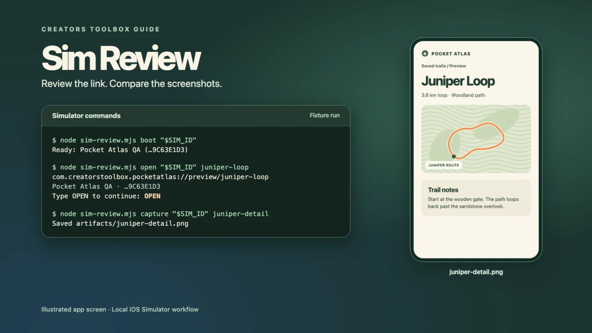

# Sim Review

A small Node CLI for reviewing your own iOS app in Xcode Simulator. It lists iOS Simulator devices, boots a selected UUID, saves a named PNG and asks for approval before opening an app preview link.



The demo uses a simulated command response and fictional app screen. It was rendered from the CLI's fixture run.

## Run

Use macOS, full Xcode with an iOS Simulator runtime, and Node.js 22. Run your app on your test device in Xcode once to install it. Check that `xcrun simctl help` works in the same terminal.

```sh
node sim-review.mjs list
SIM_ID='<UUID from list>'
node sim-review.mjs status "$SIM_ID"
node sim-review.mjs boot "$SIM_ID"
node sim-review.mjs capture "$SIM_ID" trail-before
```

The capture saves a PNG under `artifacts/`. Each label is unique, so an existing screenshot stays intact. A script or coding assistant can request a capture and return its path for review.

## Review a preview link

Register your development app's URL scheme in the Xcode target's URL Types. In `previews.json`, set that reverse-DNS scheme and name the fixture routes your app handles at `<scheme>://preview/<alias>`. The included Pocket Atlas configuration gives a fictional example.

```sh
node sim-review.mjs open "$SIM_ID" juniper-loop
node sim-review.mjs capture "$SIM_ID" trail-after
```

The first command shows the exact link and simulator. Type `OPEN` in the same terminal to proceed. A blank answer, Ctrl-C or piped input cancels. Keep the approval terminal under your control and use test data in the app.

## Check the CLI

```sh
node --test test/sim-review.test.mjs
```

The tests exercise device selection, boot, file handling and preview approval with a fixture. [Apple's command-line tool reference](https://developer.apple.com/documentation/xcode/xcode-command-line-tool-reference) covers the underlying `simctl` tool.

MIT licensed.
